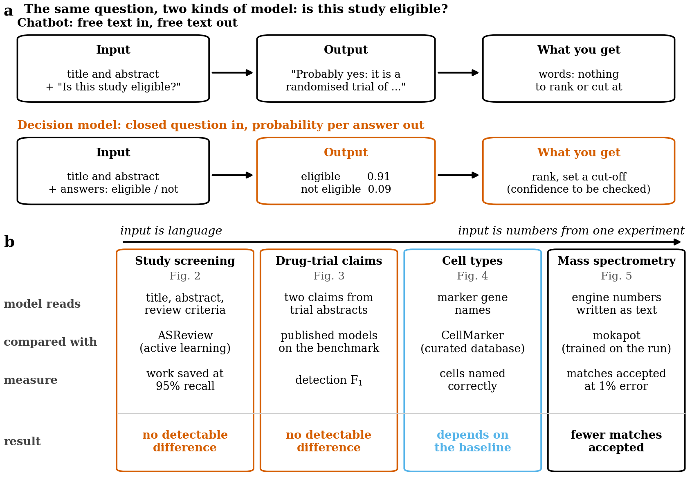
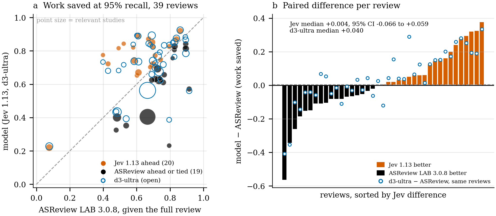
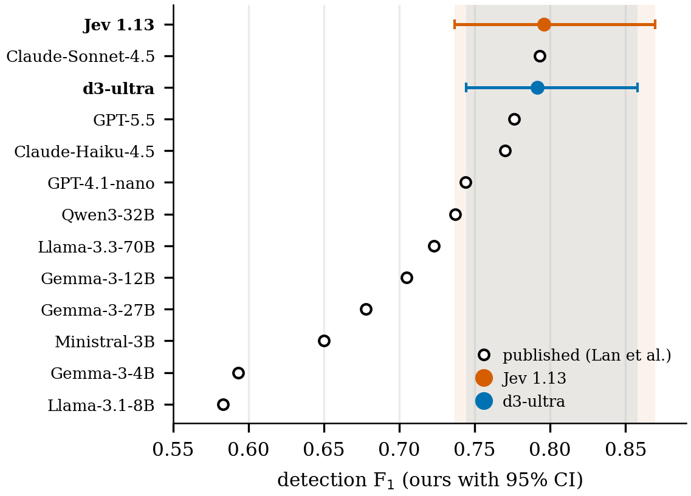
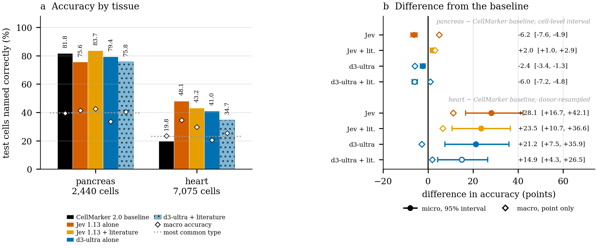
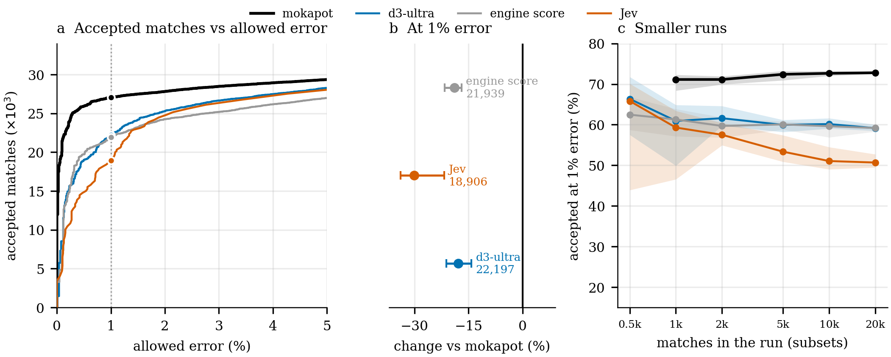

# Pretrained Decision Models in Bioinformatics: Comparable to Active-Learning Screening, Baseline-Dependent in Cell-Type Annotation, Behind a Trained Mass-Spectrometry Re-scorer

Mehmet Ali Öztürk and Simon J. Elsässer. Paper: [`paper.pdf`](paper.pdf). This repository holds the paper, its data and its code.

## The question

Much of biomedical research consists of small decisions with a fixed set of answers, repeated many times: does this
study belong in the review, do these two trial claims contradict each other, which type is this cell, is this
peptide-spectrum match correct. A decision model is a language model used for such closed questions. It is given a
case and a list of allowed answers and returns a probability for each answer, with no training on the task.

We tested two pretrained decision models, Jev 1.13 and d3-ultra, on four public bioinformatics tasks with known
answers. The tasks are ordered from text input to numeric input, and each is compared with the tool a practitioner
would otherwise use.



## What we found

The further the input moved from language toward measurements, the less the decision models added.

| Test | Measure | Jev 1.13 | d3-ultra | Comparator | Take-home |
|---|---|---|---|---|---|
| 1 Study screening | work saved at 95% recall, ideal stopping point (an upper bound) | **0.74** | **0.74** | ASReview 0.70 | no detectable difference between Jev and ASReview, without training |
| 2 Drug-trial claims | F1 | **0.796** | 0.792 | best published model 0.793 | no detectable difference from the best published model |
| 3 Cell types, pancreas | cells named correctly | 75.6% | 79.4% | **database 81.8%** | behind where the database is good |
| 3 Cell types, heart | cells named correctly | **48.1%** | 41.0% | database 19.8% (z-score version) | ahead of the usual use of the database where it is weak |
| 4 Mass spectrometry | matches accepted at 1% error | 18,906 | 12,157 | **mokapot 27,047** | behind a trained re-scorer |

Bold marks the highest value in each row and does not by itself mean a detectable difference.

### 1. Study screening: no detectable difference from active learning

Across 39 systematic reviews, reading the records in the order a decision model gave them showed no detectable
difference in the share of reading saved from ASReview, an active-learning screener that learns from the reviewer's
decisions, when both are stopped at the ideal point. No reviewer knows that point in advance, so these values are an
upper bound; the paper also reports a cut-off set beforehand.



### 2. Drug-trial claims: close to the best published model

On 1,731 expert-labelled pairs of claims from randomised drug trials, both decision models scored at the top of the
range of the eleven published language models (F1 0.58 to 0.79), with no detectable difference from the strongest
of them.



### 3. Cell types: a gain only where the database is weak

Marker lists written by a decision model were compared with the curated CellMarker 2.0 database, both used the same
way to name held-out Tabula Sapiens cells. In pancreas, which the database covers well, the database named more
cells correctly. In heart, which it covers poorly, the database needed a correction to name any appreciable share
of cells (19.8%), while the uncorrected model lists named 48.1% (Jev) and 41.0% (d3-ultra). Against another
correction of the database (26.8%) Jev's lead, with only six donors, is not firmly established.



### 4. Mass spectrometry: behind a re-scorer trained on the run

Asked whether each peptide-spectrum match is correct, the decision models accepted 30 to 55% fewer matches at 1%
error than mokapot, a re-scorer trained on the same run, and fewer than the search engine's own score (21,939).
Given to mokapot as one more feature, neither model changed its count (27,047 with Jev, 27,021 with d3-ultra).



Intervals, the pre-set screening cut-off and the caveats are in the paper; the stored results behind every
comparison, and the code that computes its interval, are in this repository.

## Repository

| Case | Folder | Task | Compared against |
|---|---|---|---|
| 1 | `data/1_screening/` | rank titles/abstracts of 39 systematic reviews | ASReview LAB active learning |
| 2 | `data/2_drug/` | detect contradictions between drug-trial claims | eleven published LLMs (DrugCon-Bench) |
| 3 | `data/3_cell/` | name cell types from marker genes | CellMarker 2.0 database |
| 4 | `data/4_massspec/` | re-score peptide-spectrum matches | mokapot trained on the same run |

Each case folder is self-contained: `README.md` (the decision-model task: question, inputs, settings, outputs, rerun
commands, known gaps), `input/`, `jev/` and `d3u/` (each model's cached answers and results), `baseline/`, `compare/`,
`code/`, and `SOURCES.tsv` (one row per file: path, source in the original study, role, whether modified, note).
`data/shared/jevlib.py` is the model client.

## Rebuild figures and paper (offline, no model calls)

```
python3 scripts/fig1_gradient.py && python3 scripts/fig2_screening.py && python3 scripts/fig3_drug.py && python3 scripts/fig4_cell.py && python3 scripts/fig5_massspec.py
mkdir -p build && pdflatex -interaction=nonstopmode -output-directory=build paper.tex && pdflatex -interaction=nonstopmode -output-directory=build paper.tex && cp build/paper.pdf .
```

Needs numpy, pandas, matplotlib and a TeX Live install. Each figure script asserts its headline numbers against the
stored results and writes every quoted value to `figs/numbers.json`.

## Limits

- Fresh model answers need paid API keys; with the cached answers no call is made.
- The mass-spectrometry spectra are attached to the `data-v1` release; `data/4_massspec/input/fetch.sh` downloads and checks them.
- Single-cell `.h5ad` files over 50 MB are not included. They are listed with size and sha256 in
  `data/3_cell/input/EXTERNAL.tsv`; `input/fetch.sh` checks them after download.
- Case-specific gaps are listed in each case README.

## Third-party data

- Case 1: SYNERGY dataset (`synergy-dataset==2.2`, CC0 1.0).
- Case 2: DrugCon-Bench annotations (CC BY 4.0); abstract text is from the PMC Open Access subset under each article's licence (`data/2_drug/input/upstream/README.md`).
- Case 3: Tabula Sapiens cells and CellMarker 2.0 markers, cited in the paper.
- Case 4: UniProt Swiss-Prot protein sequences (CC BY 4.0); spectra from PRIDE dataset PXD001468.

## Licence

Code: MIT (`LICENSE`). Paper text, figures and result files: CC BY 4.0 (`CC-BY-4.0.txt`). Third-party data keep the licences listed above.
